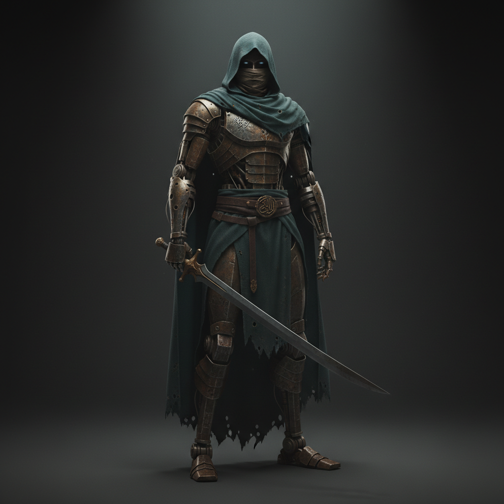

# The Vigil (working title)

A third-person melee action game in Unreal Engine 5, built around sword combat
with very smooth movement and a power curve that runs from heavy, impactful hits
in the first fight to splitting mountains in the last. A powerful country has
been quietly captured by a hidden Order. The Vigil, the warriors who once
protected its people, has been hunted down and is now hated. A new student,
trained in secret by its last surviving elders, must win back both the land and
its people's belief.

**Status:** foundation design agreed in chat on 2026-10-17. Everything below is
a foundation, not final detail. Exact numbers, names and per-move behavior are
decided during implementation.

## Hard rules

These apply to every asset, scene and line of text.

- **No real humans.** Every character is a humanoid construct that reads as a
  person: mostly covered in clothing, with human posture and body language. Why
  the world is made of constructs is never explained.
- **No faces, ever.** Masks, wrappings, hoods, visors, straw hats or shadow.
- **No NSFW content, ever.** This is absolute. The Order's moral corruption is
  shown only through its effects, never depicted.
- **No mysticism.** No spirits, seals or magic. All power comes from training,
  technique and the body.
- **The Order is fictional.** It is defined by its ideology and methods and never
  maps onto a real-world ethnic, religious or national group.
- **The Order is always smart.** Its members are never written as foolish
  villains.
- **No Ubisoft-style structure.** No map-icon clearing, no tower reveals, no
  outpost checklists.

## Pillars

1. **Impact from the first fight, escalating to the absurd.** Every hit is felt.
   By the end, clashes reshape the landscape.
2. **The parry is the heart.** Skill makes you devastatingly fast, but the game
   never requires speed to win.
3. **Bought power against earned mastery, and the truth against propaganda.**
   This theme drives the story, the villains and the progression.
4. **A beautiful, nature-rich world crossed at near-flight speed.**

## Inspirations: what we take

| Source | What we take |
|---|---|
| Sekiro | The parry as the core, heavy impact, duels against legendary warriors, a body that is upgraded (prosthetic → the hero's own frame) |
| Ghost of Tsushima | Instant stance switching, cutting down groups in under two seconds when skilled, a time-slowed chain of kills (→ Momentum Surge), beautiful open fields |
| Where Winds Meet | Fluid movement, jumping and near-flight traversal |
| Demon Slayer | Named techniques performed by masters; its **animation is the primary motion reference** for the game |

## Story

**Logline:** a powerful country's government has quietly been captured by a hidden
Order. The Vigil that once protected its people is hunted and hated, and a new
student trained in secret by its last surviving elders must win back both the
land and its people's belief.

**The country** is still strong and prosperous, but unfair. Its rich and middle
classes live normal lives, while the government no longer serves the people.
Its wealth is being drained upward and outward (see
the evidence under Freeing the country).

**The Order** is a hidden worldwide network of the richest and smartest. Its
members have some strength of their own but know their limits, so they never
fight fair: they invest in champions. Neither the people nor most officers
know the Order exists. In this country it works through the king and the
captured government. Its leader here is a smart, powerful member who knows he
cannot beat the hero himself.

**The forces of the state** are a powerful law-enforcement body inside the
country and a powerful military. Both serve the king, and through him the
Order. Most of them believe the propaganda; they are deceived, not evil.

**The fall of the Vigil.** The Vigil was once one entity with many teachers,
each with their own fighting Style, and the people loved it as their protector.
Over the years the Order killed every one of its students, by poison and other
means. Only the masters survived: crippled by the poison, they faked their
deaths and went into hiding. Propaganda then turned the people against the
Vigil, and now nearly everyone hates it. Praising the Vigil or training in its
manner gets you arrested.

**The hero** is a new student, trained in secret by the survivors: the rusted,
hooded construct shown above. Its home is the Vigil's hidden hub, where the
**First Teacher** lives. The other poisoned **elders** are scattered across the
country in hiding.

### The arc

1. **The fugitive (early).** Alone, hunted and feared by the people it is trying
   to save, the hero works from the shadows and dismantles the Order's hidden
   cells one place at a time.
2. **The return of belief (mid).** The hero's actions start to undo the
   propaganda. Some people believe in the Vigil again, and a few secretly begin
   training with the elders. The Order notices and adapts, investing in stronger
   champions.
3. **The uprising (late).** As the truth spreads, some law-enforcement and
   military units learn whom they have been serving and break away. The country
   splits into the awakened (citizens, defectors, trainees) and the forces still
   deceived or bought. This leads to open battles with **hundreds on each
   side**, the Order's greatest champions and, last, the Order's leader in this
   country.

**Hook:** the Order is global, and this was one country.

## Freeing the country

No territory is taken back, because there is no occupier. In each part of the
country the Order runs a **hidden cell**: an agent, the local officials it has
bought, and **one concrete scheme** that harms the people there. The hero
uncovers the cell, removes it and **exposes its proof to the people**. The
scheme stops, the corrupt officials are exposed, and that place begins to doubt
the propaganda. The Order responds intelligently, by spinning the hero's
actions as crimes and by funding stronger champions.

### The schemes and their evidence

Every scheme is visible in the world and provable through ledgers, letters,
decrees and conversations.

| Scheme | What players see |
|---|---|
| **Repair monopoly.** Repair, parts and oil are a construct's healthcare, and Order-linked houses now hold the licenses. | Closed workshops, prices doubled, poor constructs rusting and seizing up in the streets, while the rich get polished |
| **Debt and land seizure.** New laws let lenders seize land and homes over small defaults. | Eviction notices; farmers working their own former fields as tenants for Order-held companies |
| **Taxes that flow one way.** Working and middle-class taxes rise while Order-linked trading houses receive exemptions and monopolies (grain, iron, salt). | Price boards rising month by month; tax ledgers showing who pays and who doesn't |
| **Rewritten education.** Curricula changed, history erased, good teachers dismissed, obedience taught. | Old textbooks beside new ones; empty classrooms; students reciting slogans |
| **Justice for sale.** The poor are jailed for small offenses while the rich buy verdicts, and dissenters disappear. | Prison registers, bribe receipts, families searching for missing relatives |
| **Broken families.** Labor relocations to distant Order-owned mines, and Order-funded entertainment that mocks loyalty and family. Shown only through its effects. | Divided households, homes with empty chairs, propaganda theaters |
| **Selling the country.** The country's resources quietly sold abroad at a loss to foreign Order-linked houses. | Export docks loading the country's wealth onto foreign ships; contracts signed by the king's ministers |

### Trust

Trust is the people's belief in the Vigil against the propaganda. It is the
backbone of the story's progression, not a combat stat.

- **Raised by:** exposing schemes with evidence, rescuing the arrested, helping
  communities, sparing the deceived.
- **Lowered by:** the Order's counter-propaganda, and killing the deceived when
  mercy is off.
- **Unlocks:** shelter, informants, trainees, defectors and finally the uprising.

## World

**Structure.** One seamless World Partition world. The regions are dense and
handcrafted; the land between them starts simple, is built with PCG
(PCGToolset), and gains detail over time. Everything can be crossed on foot,
which keeps late-game mobility meaningful.

**Era and technology.** The equivalent of the 13th–16th centuries, the same era
as Sekiro and Ghost of Tsushima. Clockwork and pre-gunpowder: bronze, iron,
gears, springs and cloth. No firearms; the weapons are swords, spears, polearms,
bows and crossbows, so sword mastery is naturally the peak of power.

**Art direction: an East Asian land with Andalusian grace (about 70/30).**

- **East Asian base:** timber halls with sweeping tiled roofs, mountain
  monasteries, castle-fortresses, bamboo and pine forests, terraced fields,
  wooden bridges, straw *kasa* hats.
- **Andalusian accents** in cities, palaces and gardens: courtyards with
  fountains and running water channels, horseshoe and multifoil arches,
  geometric tilework (zellige) and carved plaster, walled gardens of orange
  trees and cypress, and water wheels (a motif both traditions share).
- **Historical anchors:** the Alhambra in Granada (Islamic architecture in a
  green, mountainous land) and the Great Mosque of Xi'an and medieval Quanzhou
  (Chinese timber architecture with Islamic ornament).
- **Costume and armor:** layered robes and wide trousers, hooded cloaks, head
  wraps, masks and straw hats; lamellar armor; curved single-edged blades
  (tachi, dao, saber).
- **Palette:** forest greens, river blues, terracotta and ochre roofs, and
  turquoise glaze tying in with the hero's teal cloak, against bronze and brass
  constructs.
- **The game must look beautiful.** Nature makes up most of the world.

**Landscapes:** river valleys and green terraced fields; lakes, orchards and
garden cities; highland meadows of tall grass and flowers; forests; snow peaks
for late-game fights; and a rocky frontier of red-rock canyons and dry steppe
with no sand dunes.

**The hub** is one of the most beautiful places in the game: a sunlit high
mountain sanctuary under clear sky, with a huge open view over the country. The
only mist is a sea of clouds far below it in the mornings, which is why nobody
in the valleys has found it. Here are the First Teacher's home, the practice
grounds, the gardens and the upgrade workshop.

**Key places:** towns and cities, forts and garrisons, prisons, each scheme's
Order sites (counting houses, estates, licensing bureaus, export docks) and the
capital palace.

## Factions and enemies

**Power structure:** the king and government (visible, captured) → the state
forces (loyal, deceived) → the Order (hidden cells, champions). Against them
stands the Vigil: the hub, the First Teacher and the elders, joined later by
trainees and defectors.

All enemies are constructs, and their faces are always hidden.

| Family | Who they are | Combat role | Where you meet them |
|---|---|---|---|
| **Law enforcers** | Patrols, investigators, arrest squads | Catchpoles and polearms that pin and trap; nets; whistles that call reinforcements; trackers who hunt the hero | Towns, roads, checkpoints, prisons |
| **Military** | Soldiers (spear, sword, shield, bow), heavy elites, officers | Group fights; shields and heavies force Style switches; archers punish standing still; officers are duel-level | Forts, garrisons, frontier camps, late battlefields |
| **Order agents** | Spies, informants disguised as citizens, assassins | Fast and evasive; carry **the poison**, which corrodes joints and drains Momentum | Inside cells, in disguise, ambushes |
| **Order members** | Leaders of each cell: smart, with some strength | Never fight fair: traps, bodyguards, escape routes; some survive to return | At the heart of each scheme |
| **Champions** | Bought legends, each with a unique style and a custom body the Order paid for | Boss duels; they escalate alongside the hero, and some are built to counter its favored Styles | Story bosses, scheme guardians, the finale |
| **Mercenaries** | Hired blades for the Order's deniable work | Varied, rough fighters, with the occasional hidden duelist | Frontier, smuggling routes |
| **Wandering duelists** | Independent masters who fight for honor or money | Optional pure-skill duels | Anywhere |

## Combat

### The core loop: Read → Answer → Punish

- **Read:** every attack shows what it is: normal, heavy, flurry, grab, poison
  strike.
- **Answer:** a perfect **parry** (universal, the centerpiece), a **dodge** or a
  **Style counter**.
- **Punish:** the answer creates an **Opening**, and fights are won through
  Openings.

### Momentum and Resolve

**In one line: aggression builds your Momentum; mastery breaks their Resolve.**

- **Momentum (the hero).** It builds through aggression, perfect parries, perfect
  dodges and well-timed Style switches. It is spent on Techniques. Blocking
  without parrying drains it; if it reaches zero while blocking, the guard
  breaks.
- **Resolve (enemies).** Discrete pips, shown physically: armor cracks, the
  stance falters, cloth tears. **Only Openings crack Resolve**; hitting a guard
  does not. Breaking every pip allows a **decisive blow**.
- **Toughness scale.** Ordinary soldiers have 0–1 pips, so one Opening kills
  them and a skilled player can cut down five in under two seconds. Elites have
  2–3. Champions and legends have many, and every crack is a cinematic beat.

This is deliberately not Sekiro's posture meter. Constant pressure fuels the
hero; only precise moments break the enemy.

### Styles

The Vigil's teachers each teach one **Style**, and switching between Styles is
**instant**. A Style defines:

1. **its moveset;**
2. **what a perfect parry turns into.** The parry input is identical in every
   Style, but the follow-up is different: a riposte, a throw, a launch into the
   air, or a sweeping cut through a group. This is why players switch mid-fight;
3. **which defenses it breaks:** shields, heavy armor, polearm reach, evasive
   fighters;
4. **its Techniques:** named forms that cost Momentum.

**Style weaving:** switching Style exactly as a parry or hit lands earns bonus
Momentum. This is the skill ceiling; it is optional but devastating.

### Momentum Surge

At full Momentum, the hero can trigger a time-slowed chain of decisive cuts
through several enemies. It grows in length and power over the game.

### Mercy setting

Lethal or non-lethal finishers, chosen as a simple setting. It has minimal
effect on the combat system. Its effect is on **Trust**: sparing the deceived
wins people back. Details are decided during implementation.

### Power curve

Impact is high from the first fight and keeps rising. Specifics are decided
during implementation.

| Stage | Scale |
|---|---|
| Early | Heavy, impactful hits; enemies are thrown by blows |
| End of early game | Slashes shake the earth |
| Late | Mountains split, terrain deforms, knockback and leaps reach toward the edge of space, and people and objects are thrown around by every impact and clash |

## Movement

Movement and combat are one system: a dodge is a dash, a dash flows into an
attack, and a jump cancels into an aerial strike. It must feel smooth, weighty
and instant, with tight cancel windows and no input lag.

| Stage | Movement |
|---|---|
| Early | Sprint, combat dash, high jump, free climbing, wall kicks, ledge grabs, slides |
| Mid | Burst dash (tens of meters), air dash, lightness technique (running across walls and water, long cloak glides): trained physical mastery in the spirit of wuxia *qinggong* |
| Late | Flash step (hundreds of meters in an instant), chains of sky dashes that are almost flight, leaps across terrain |

**Stealth** supports the fugitive act (hiding in crowds and grass, silent
takedowns) and is always optional. **No mount** is planned; by mid-game the
hero outruns any animal.

## Progression

Power comes from mastery and the body, never from loot.

1. **Styles**, from elders found through exploration and rumor in any order.
   Each elder sets a short trial at their hiding place before teaching.
2. **Techniques**, learned from the First Teacher and the elders and sharpened
   at the practice grounds.
3. **The body:** the construct frame, upgraded at the hub with materials found
   or won in the world. Upgrades raise output, speed and durability and add new
   traversal and combat tools.
4. **Momentum Surge**, which grows over the game.
5. **Trust**, the people's progression (see Trust under Freeing the country).

There is no gear score or loot treadmill; every upgrade is a deliberate step.
Challenge with a non-linear order of elders comes from **the Order's
escalation** (stronger champions, counters to the hero's habits), not from
level numbers on enemies.

## Technical foundation (Unreal Engine 5)

| Need | Starting point in UE5 |
|---|---|
| Smooth, responsive movement | Motion Matching (Pose Search) blended with authored combat montages and explicit cancel windows |
| Styles, Techniques, Momentum, Resolve | Gameplay Ability System (abilities, attributes, gameplay tags) |
| Large impact and clash effects | Niagara |
| One seamless world | World Partition, with PCG (PCGToolset) for connecting land |
| Flying bodies and debris | Chaos physics and destruction |

### Technical risks to prove early

1. **Runtime terrain deformation.** The standard Landscape isn't built for
   runtime geometry changes. Mountain-splitting needs a different approach
   (destructible or dynamic-mesh terrain sections, a voxel solution, or
   authored destruction set pieces). Evaluate this before content production.
2. **Extreme vertical range.** Fights that reach toward the edge of space need
   streaming, LOD, sky and camera behavior that hold up at that height. Large
   World Coordinates and Sky Atmosphere are the starting points.
3. **Battles of hundreds.** Hundreds of fighters at once need a crowd approach
   (for example, Mass Entity with cheaper distant animation), not hundreds of
   full characters.
4. **Physics at scale.** Many bodies and objects being thrown at once must stay
   stable and performant.
5. **Motion Matching against combat precision.** Fluid motion must not cost
   input responsiveness or exact parry timing.

## Roadmap

The game is built as separate projects, each with its own plan.

1. **Foundation design.** This document.
2. **Combat prototype.** One arena, the hero, a group of soldiers and one
   champion duel, with the parry, Momentum, Resolve, two Styles and Surge. It
   also runs early spikes on risks 1, 4 and 5.
3. **Character pipeline.** The hero from concept to character sheet, model, rig
   and animation, using the workspace's character, materials and animation
   skills.
4. **Movement prototype.** Movement from the early kit through to near-flight.
5. **Content.** Regions, schemes, enemy families, champions, Styles and
   Techniques.

**Next step:** plan the combat prototype.

## Open questions

- The king's fate.
- Names: the game, the country, the hero, the First Teacher, the elders, the
  Styles, the Order's leader, the law-enforcement body and the military.
- The number of regions, elders and Styles.
- How rumors lead to elders without map icons.
- Whether champions use Momentum and Techniques of their own.
- Whether the world has animals, and what they are.
- Mercy-setting details and specific power-curve values, decided during
  implementation.
